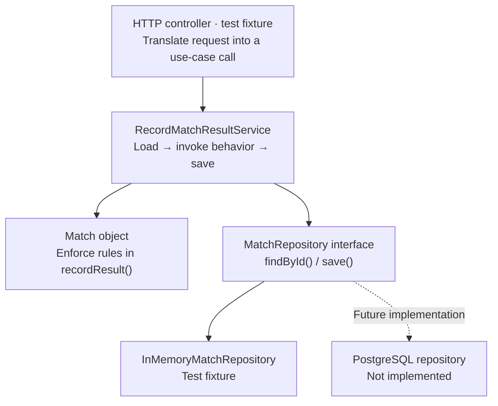

# SkillBetting system map

## Current deployment boundary — 2 November 2026

The owner-approved release contains Xeri, Diloti, Koum Kan, Thanasis, Biriba, Tichu and human-only chess PvP. Chess uses the strict proof-artifact profile; computer play remains disabled. Production rejects funding for any unregistered engine without changing credits. Health/registration/Platform are the public runtime; the old Match prototype remains unregistered. `/health/ready` requires migration 009. Production retains stable configuration and the single controlled edge hop. The [container runbook](../deploy/README.md) and [server-agent handoff](../deploy/SERVER-AGENT.md) cover deployment, backups and recovery. Public deployment is separate from the passing local checks; see the [current checkpoint](backend-progress.md). External payments, computer/chat workflows and paid-result corrections remain inactive.

All seven games have registered adapters and authenticated participant-only HTTP/native websocket actions. The six card games retain round results/Next; Diloti/Koum Kan provide exact read-only selection feedback. Chess is a single standard game with fixed seat colours, legal moves/promotion, draw commands and authoritative results. See [chess actions](platform-api.md#chess-participant-actions--approved-2-november-2026) and [card actions](platform-api.md#card-gameplay-integration--1-november-2026).

Start here for the overall picture. The [API and use-case catalog](api.md) describes behavior; the [architecture notes](architecture.md) explain implementation decisions.

The [multiplayer table decisions and plan](multiplayer-tables.md) records the owner-confirmed shared public/private flow for all seven games. The [credit plan](credits.md) establishes one currency and equal table/credit capabilities for generated and registered accounts. The [shared table/ledger/ticket API and websocket foundation](platform-api.md) is now implemented; shared match history and initial settlement are now implemented; Xeri/Diloti/Koum Kan game actions and approved frontend activations are now implemented. See the [checkpoint](backend-progress.md) for checks/local migration status. Every further frontend change must be discussed and explicitly agreed first, including changes within existing controls.

## Ecosystem

Solid arrows show the running HTTP path. Dotted arrows show future connections or areas being explored. A box on this map does not necessarily represent a Nest module, separate service, or deployment.

```mermaid
flowchart TD
    person["Player / operator"]
    frontend["Next.js frontend · lobby, accounts and Xeri/Diloti/Koum Kan PvP"]
    person --> frontend
    frontend -- "/api proxy" --> api

    subgraph backend["SkillBetting web backend"]
        api["Web API · implemented"]
        health["Health check · live endpoint"]
        registration["Accounts · signup, sessions, Demo, verification"]
        tables["Tables · funded tickets · credits · Xeri/Diloti/Koum Kan gameplay"]
        matches["Matches · internal prototype"]
        candidates["Candidate business areas<br/>Identity · Challenges · Integrity<br/>Settlement · Wallet"]
        api --> health
        api --> registration
        api --> tables
        api -. "Match endpoints not exposed yet" .-> matches
        api -. "Future capabilities" .-> candidates
    end

    registration --> db[("PostgreSQL<br/>Users, sessions, ledger, tables/tickets") ]
    tables --> db
    matches -. "Future Match repository" .-> db
```

Game Bridge and game-provider integrations are outside this backend increment. Their future connections are not designed here. Single-credit grants, reservations, releases and start funding are implemented; shared initial result payouts/refunds are now implemented by migration 008 and controlled-adapter tests. Deposits, withdrawals and paid-result corrections remain separate.

The [chess engine](../engines/chess/README.md) connects through `ArtifactChessGameRuntime`, dedicated proof workers and PostgreSQL proof storage. Only the strict.2 artifact profile can enter funded games; raw/default analysis states cannot. See [chess actions](platform-api.md#chess-participant-actions--approved-2-november-2026).

## Business responsibilities

These names describe candidate responsibility boundaries. They do not commit us to six modules or six services.

| Area       | What it is responsible for                                               | Current state                                                                                                                                                             |
| ---------- | ------------------------------------------------------------------------ | ------------------------------------------------------------------------------------------------------------------------------------------------------------------------- |
| Matches    | Competition state, participants, recorded outcomes, and result history.  | Small domain class and internal result-recording service.                                                                                                                 |
| Identity   | Who users/callers are and which actions they may perform.                | Accounts, sessions, verification, login/profile and equal session-bound table capability implemented; game/result permissions remain scoped to future engine integration. |
| Challenges | Objectives and their success/failure conditions.                         | Candidate area only.                                                                                                                                                      |
| Integrity  | Disputes, investigations, review decisions, and verification confidence. | Candidate area only.                                                                                                                                                      |
| Settlement | Whether an authorized outcome is eligible for financial settlement.      | Candidate area; outside the initial implementation.                                                                                                                       |
| Wallet     | Financial records, balances, ledger consistency, and payout state.       | Single-credit ledger, reservations, start funding and initial result settlement implemented; deposits/withdrawals and paid-result corrections pending.                    |

For the next increment, Wallet has a confirmed one-currency target with durable reservations and tickets; its ledger/reservations/tickets are implemented by migrations 006/007. Table membership/readiness, the one-active-table constraint and native live updates are implemented; shared lifecycle/settlement is implemented; Xeri/Diloti engine actions are integrated, while other game adapters remain pending. Accounts expose no caller-selected privilege fields; both creation paths use the same implemented session/funds checks for tables. See the linked plans for the exact fixed prices, pre-start full releases and intentionally untimed disconnect behavior.

Authorized revisions to official match outcomes, preserving previous result records, are a confirmed mandatory requirement. The existing history-shaped Match model is retained; revision behavior and authority are not implemented yet. See the [architecture decision](architecture.md#match-behavior-and-responsibility).

## Inside one use case

This is the implemented result-recording path in the HTTP tests. The controller and in-memory repository exist only in tests. The service and domain class are application source code.



For a production Match endpoint, we still need a PostgreSQL implementation of the repository and an established authorization boundary. The domain class will continue to enforce its own rules.

## Turning a feature idea into implementation

Use this sequence when discussing new work:

```text
User goal → use case → caller permissions → endpoint contract → implementation
```

For example, “a player wants to see a match's result history” is enough to start a discussion. We can then decide what they may see and how to expose it. This example is an idea, not an approved feature.

A use case can run from HTTP, a background task, or another trusted component. It therefore does not always need its own endpoint, and an endpoint list alone will not describe every system capability.

## Keeping the picture current

When a feature is agreed or implemented, update its state here and add or revise its entry in the API catalog in the same change. Keep proposed behavior clearly marked until it is agreed, and keep endpoint contracts aligned with controllers and HTTP tests.
